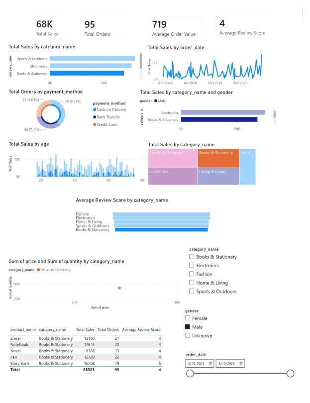
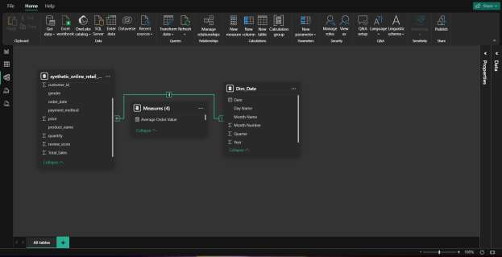

# Online Retail Sales Dashboard (Power BI)

An interactive Power BI dashboard that turns 1,000 online retail transactions into insights on sales performance, customer behaviour and product trends. Built as Year 2, Semester 1 coursework for the Data Analytics module at APIIT Sri Lanka.

*The screenshot is shown with the Male and Books & Stationery filters applied.*

## Problem

The raw retail data had missing review scores and gender values, coded values (`M`/`F`), text-formatted dates and no revenue field. It was not ready for business reporting.

## ETL in Power Query

- Converted `order_date` from text to Date
- Replaced `M`/`F` with Male/Female, and filled missing gender with `Unknown`
- Kept missing review scores as null, so they don't distort averages
- Removed columns with no analytical value (`category_id`, `product_id`, `city`)
- Added a `Total_Sales` column (quantity × price)
- Built a `Dim_Date` table (Year, Month, Quarter, Day Name) and a star-schema model

## Dashboard

- **KPI cards:** Total Sales, Total Orders, Average Order Value, Average Review Score (DAX measures)
- **Charts:** sales by category, sales over time, orders by payment method, sales by category and gender, sales by age, category treemap, review score by category, price vs quantity scatter, and a product summary table
- **Slicers:** category, gender and order date

## Dataset

[Synthetic Online Retail Data](https://www.kaggle.com/datasets/ertugrulesol/online-retail-data) (Kaggle). It has 1,000 transactions across 5 categories (Electronics, Fashion, Sports & Outdoors, Books & Stationery, Home & Living), from March 2024 to March 2025.

## Files

| File | Description |
|---|---|
| `online_retail_dashboard.pbix` | Power BI report |
| `data/synthetic_online_retail_data.csv` | Source dataset |
| `report/Written_Report.pdf` | Written report: scope, ETL, reflection and evaluation |

## How to open

1. Install [Power BI Desktop](https://powerbi.microsoft.com/desktop/) (free, Windows).
2. Open `online_retail_dashboard.pbix`.
3. If Power BI asks for the data source, go to **Transform data → Data source settings**, choose **Change Source** and point it to `data/synthetic_online_retail_data.csv`.

## Tech

Power BI Desktop, Power Query (M), DAX, star-schema data modelling

## Author

**Vidusha Athukoralage**, BSc (Hons) Artificial Intelligence undergraduate, APIIT Sri Lanka
